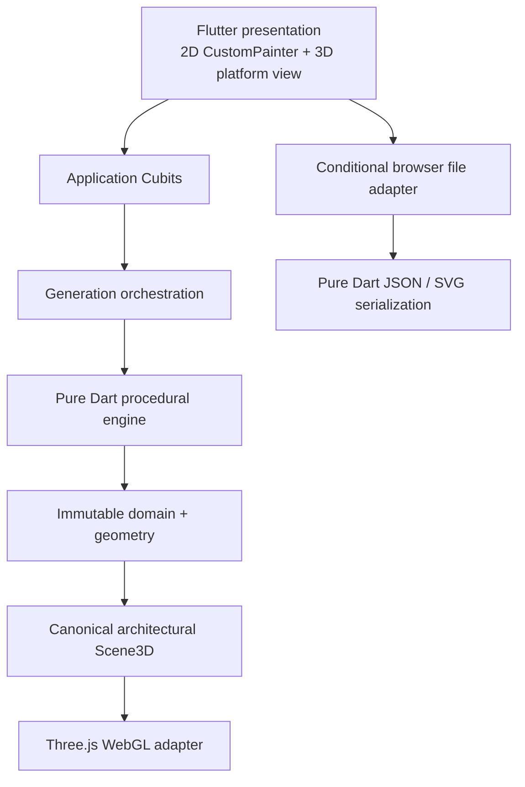

# Forma — Generative Residential Design

Forma is a local-first Flutter Web application for generating and comparing deterministic **conceptual residential floor plans**. A structured project brief—lot, setbacks, floors, rooms, floor preferences, and spatial relationships—is converted into multiple real geometric alternatives. Invalid layouts are rejected; valid layouts are scored and ranked.

This is an early generative-design foundation. It is not an AI image generator, LLM wrapper, CAD editor, code-compliance checker, or source of construction-ready documents.

## What works

- Rectangular sites with north, south, east, or west street frontage
- Relative front/rear/left/right setbacks and derived buildable envelope
- One or two floors and an editable room program
- Centralized room-area and minimum-dimension heuristics
- Explicit hard constraints and weighted soft spatial preferences
- Deterministic xorshift32 randomness from a user-controlled numeric seed
- Area-guided recursive slicing/BSP layout generation on a 0.25 m grid
- Multiple candidates, hard validation, category scores, deduplication, and ranking
- Candidate selection, floor switching, pan/zoom, and selectable room inspection
- Interactive WebGL 3D with connected floor massing, an attached garage wing and driveway, gabled/flat roofs, facade openings, Exterior/Cutaway modes, and synchronized selection
- Versioned project JSON import/export and domain-generated vector SVG export
- Feasibility errors and generation rejection diagnostics

## Run

```bash
flutter pub get
flutter run -d chrome
```

For a release web bundle:

```bash
flutter build web
```

The Web bundle vendors Three.js locally at an exact version, so the application
does not depend on a runtime CDN. When upgrading the renderer dependency, run
`npm install` followed by `npm run vendor:three` and commit the refreshed files
under `web/vendor/three`.

The first launch contains a ready-to-run two-floor sample project. Its generated geometry is not hardcoded: click **Generate** to search from the sample requirements and seed `839172`.

## Architecture



The dependency boundary is deliberate: `lib/engine` imports no Flutter libraries. Geometry is always stored in meters. `FloorPlanPainter` transforms meters into 2D pixels, while `ArchitecturalSceneBuilder` derives levels, slabs, spaces, and unique wall topology for renderers. Browser APIs are contained in conditional adapters.

### Generation pipeline

1. Validate obvious feasibility failures.
2. Expand room counts into stable, unique room instances.
3. Honor locked floors and heuristically balance flexible rooms.
4. Choose a seeded ground footprint, reserve a street-facing attached garage wing, and keep the upper floor over the habitable support zone.
5. Anchor upper massing toward the rear/side and align its stair core with the floor below.
6. Recursively split available rectangles with an explicit slicing tree. Subtree target areas guide split ratios; small seeded perturbations provide alternatives.
7. Snap every partition to the configured 0.25 m grid.
8. Reject missing, overlapping, out-of-bounds, undersized, off-grid, unsupported, inaccessible-garage, or disconnected-stair layouts.
9. Score relationships, proportions, street orientation, compactness, and floor preferences.
10. Deduplicate geometry, sort by normalized 0–100 score, and retain the configured top candidates.

Identical requirements, settings, and seed produce identical geometry, scores, and ranking. The PRNG uses only explicit 32-bit operations so behavior is stable on both the Dart VM and JavaScript builds.

## Hard and soft constraints

Hard constraints invalidate a candidate: required counts, legal bounds, no overlaps, valid geometry, minimum area/dimensions, locked floors, occupied-area vertical support, garage access from the street facade, overlapping stair cores, maximum total area, and grid alignment.

Soft constraints affect rank without invalidating a design: adjacency, near/away relationships, street distance, target-area fit, proportions, footprint compactness, and flexible-floor preference. The inspector exposes both category scores and per-preference satisfaction.

## Project structure

```text
lib/
  app/                 theme and root composition
  core/                geometry, deterministic random, serialization, platform boundary
  domain/              sites, requirements, projects, constraints, generated designs
  engine/              generation, slicing, validation, scoring
  features/            Cubits and presentation by product concern
test/
  core/ domain/ engine/ widget_test.dart
docs/
  architecture.md generation_algorithm.md
```

See [architecture.md](docs/architecture.md) and [generation_algorithm.md](docs/generation_algorithm.md) for implementation details.

## Test and quality gates

```bash
dart format .
flutter analyze
flutter test
flutter build web
```

Tests cover geometry, all street orientations, serialization roundtrips, feasibility, scoring rules, deterministic replay, differing seeds, and repeated generation invariants.

## Current limitations

- Rectangular lots and rectangular slicing layouts only
- Rectangular room partitions with a supported L-shaped attached-garage composition; no general free-form footprint or circulation graph synthesis
- No furniture, structure, plumbing, sunlight, irregular boundaries, or manual wall editing
- Roofs, driveway, and facade openings are heuristic preview geometry; doors/windows are not yet editable wall cutouts or a complete circulation graph
- Heuristics are not jurisdictional codes or professional architectural review
- Generation runs bounded on the browser event loop; the engine boundary is ready for a future Web Worker executor
- Hill-climbing genome mutation is not yet enabled; the current search uses independent seeded slicing candidates

The best next technical milestone is a retained slicing-tree genome plus mutation optimizer (subtree swaps, split rotation, and ratio mutation), followed by circulation/door feasibility.
